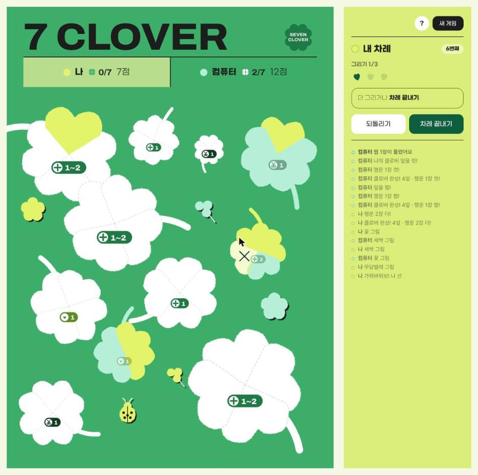

# 7 CLOVER (세븐 클로버)

차례마다 클로버 잎을 1~3장 칠하고, 마지막 잎을 칠한 사람이 클로버의 주인이 되는 2~4인 게임이에요.
네잎 클로버 7개를 먼저 모으면 승리! 종이와 펜으로 하는 PnP 보드게임 「7 CLOVER」를 웹에서 바로 할 수 있게 옮겼어요.

**▶ 바로 하기: https://dangnuie-web.github.io/seven-clover/**

## 규칙 한눈에

- 내 차례에 잎을 **1~3장** 칠해요. 여러 클로버에 나눠 칠해도 되고, 잎 대신 무당벌레·꽃·새싹을 칠해도 돼요.
- 클로버의 **마지막 잎**을 칠한 사람이 그 클로버의 주인. 클로버에 적힌 **행운**을 그 차례 안에 써요.
  - **더!** 적힌 장수만큼 꼭 더 칠해요.
  - **찜!** 빈 잎에 하트를 그려 맡아 둬요. 다음 내 차례가 끝날 때까지 안 칠하면 하트가 지워져요.
  - **컷!** 칠해진 잎 하나를 X로 지워요. 남의 네잎 클로버를 세잎으로!
- **빠른종료**: 네잎 클로버 7개를 먼저 모으면 바로 승리.
- **빅매치**: 모든 클로버가 칠해지면 점수 계산 — 4잎 5점 · 3잎 3점 · 2잎 5점 · 1잎 7점 · 무당벌레 2점 · 꽃·새싹 1점.

자세한 규칙은 게임 안 **?** 버튼에서 볼 수 있어요.

## 하는 법

- 시작 화면에서 **컴퓨터 대결**(나 + 컴퓨터 1~3명) 또는 **돌려하기**(한 기기로 2~4명)를 골라요.
- 2명은 2인용 시트, 3~4명은 3~4인용 시트로 해요.
- ⌘Z / Ctrl+Z: 내 차례 안에서 되돌리기 · Enter: 차례 끝내기
- 시트 오른쪽 위 클로버 로고: 새 게임

## 만든 방식

설치나 빌드 없이 HTML·CSS·자바스크립트 파일 세 개로 돌아가요. `index.html`을 브라우저로 열면 바로 실행돼요.

## 라이선스

- 코드: MIT
- 게임(규칙·시트 디자인)·커버 그림: © 2026 Dangnee, all rights reserved
- 폰트: Pretendard(jsDelivr)·Archivo(Google Fonts) — SIL OFL 1.1, G마켓 산스(jsDelivr) — 무료·상업 이용 가능. 저장소에는 넣지 않고 링크로 불러와요

자세한 내용은 [LICENSE](LICENSE)를 봐 주세요.

만든 사람: Dangnee(당니) · [github.com/dangnuie-web](https://github.com/dangnuie-web) · dangnuie@gmail.com
